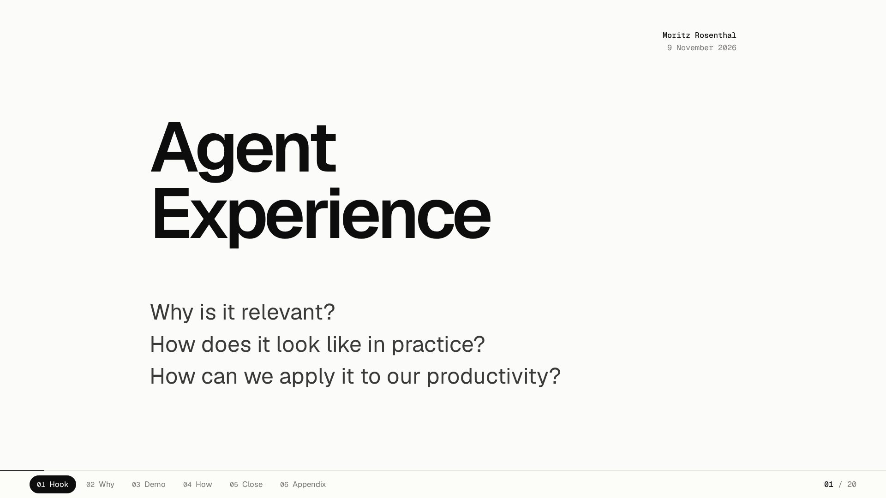
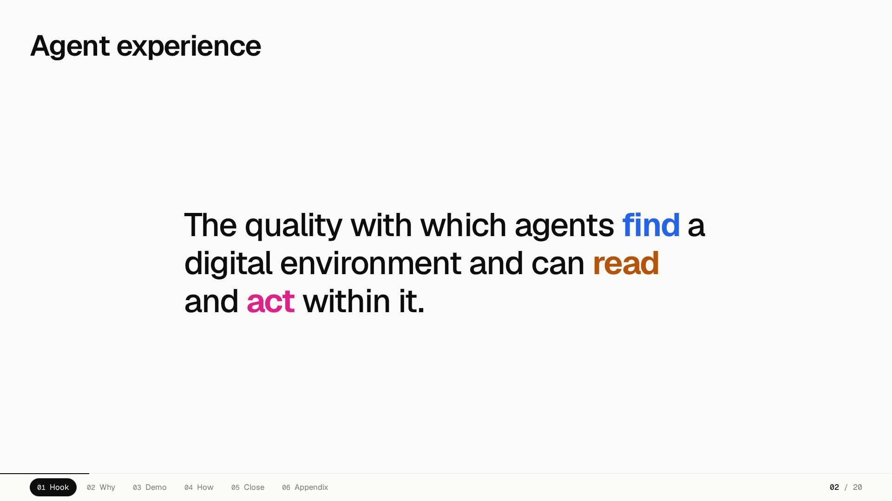
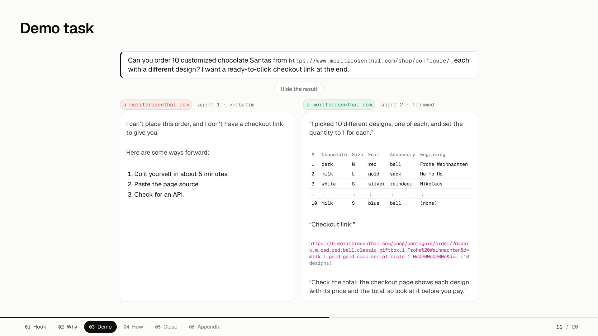

# Agent Experience

**[▶ Open the slides](https://moritz-rsth.github.io/agent-experience/)** · 20 slides · one self-contained HTML file · works offline

A 10-minute talk at the weekly meeting of the TUM Chair of Digital Marketing, 9 November 2026. Agent experience (AX) is the quality with which AI agents *find* a digital environment and can *read* and *act* within it. The talk asks why it matters, shows it on a small online shop, and ends with what it means for the tools we use ourselves.

[](https://moritz-rsth.github.io/agent-experience/)

## What's inside

| | |
|---|---|
| [](https://moritz-rsth.github.io/agent-experience/#2) | **One definition, three verbs.** Find, read, act. The same three colours come back on the diagram slides and in the closing part about personal agents. |
| [](https://moritz-rsth.github.io/agent-experience/#11) | **The same task, two shops.** A chocolate-Santa configurator exists twice: [a.moritzrosenthal.com](https://a.moritzrosenthal.com/shop/configure/) is browser-only, [b.moritzrosenthal.com](https://b.moritzrosenthal.com/shop/configure/) adds a text-shaped path for agents (`/api/configure`, `llms.txt`, `agents.md`). Humans see the same shop on both. An agent asked for ten customized Santas fails on a. and hands back a checkout link on b. The answers on the slide are real and recorded; the link opens the real checkout page. |

Navigate with **← / →** or **space**, or click the section pills at the bottom. Slides 9 and 10 embed the live shop when you are online. The page is a single 1.4 MB HTML file with fonts, images and diagrams inlined, so you can download [`index.html`](index.html) and present it offline.

## Repository layout

```
index.html            the deck (GitHub Pages serves it as the site root)
deck-src/             the source the deck is built from
  deck_src.html       slides as HTML, with {{asset}} placeholders
  diagrams/           Python scripts that draw the SVG diagrams
  assets/             images, logos and SVGs used in the slides
```

The deck is built with the `slides` skill from [moritz-skills](https://github.com/moritz-rsth/moritz-skills), which inlines every asset into one file.

## Sources and license

The 16 sources (the ora paper, WebMCP, Cloudflare, Shopify, Vercel, TechCrunch, Meta) are listed on the last slide. Logos and screenshots belong to their owners. Everything else is MIT-licensed.
